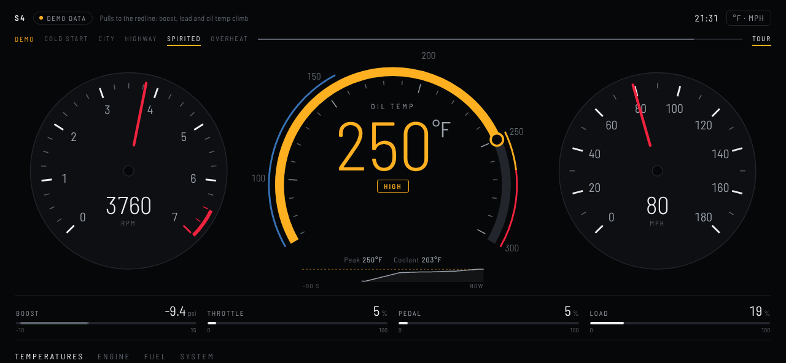

# S4 Cockpit — Raspberry Pi OBD2 gauge

A Raspberry Pi 4 reads live engine data from a 2013 Audi S4 (B8.5, 3.0 TFSI) through a USB OBD2 adapter, creates its own Wi-Fi network, and serves a cockpit-style dashboard to an iPhone in Safari. The main goal is oil temperature, which the car only reports through a manufacturer-specific code, so the project includes a script that finds it.



Demo video: [`docs/s4-cockpit-demo.mp4`](docs/s4-cockpit-demo.mp4) (cold start → city → highway → spirited → overheat warning, simulated data).

## What it shows

- Oil temperature as the main gauge: blue when cold, white in range, amber when high, red when critical, with peak and a trend line
- Tachometer and speedometer
- Boost, throttle, pedal and engine load
- Coolant, intake air, ambient and catalyst temperatures; timing, MAF, manifold pressure; fuel level and fuel trims; battery voltage
- °F/mph or °C/km/h

## Hardware

- Raspberry Pi 4B (any RAM size)
- USB OBD2 adapter that speaks ELM327/STN commands and supports `ATSH` (tested design: Vgate vLinker FS USB; OBDLink SX also fine)
- 12 V socket adapter with a USB-C port rated 5 V / 3 A

## Install

Full beginner walkthrough: see the step-by-step setup guide shared with this project. In short:

1. Flash **Raspberry Pi OS Lite (64-bit)** with Raspberry Pi Imager: hostname `s4gauge`, user `pi`, your home Wi-Fi, SSH enabled.
2. Connect with `ssh pi@s4gauge.local`, then download and install, giving a password (8+ characters) for the gauge's Wi-Fi:

   ```bash
   sudo apt install -y git
   git clone https://github.com/IZ-2008/S4-Gauge.git ~/S4-Gauge
   bash ~/S4-Gauge/s4gauge/install.sh YOUR-HOTSPOT-PASSWORD
   sudo reboot
   ```

3. On the phone, join the Wi-Fi **S4-Gauge** and open `http://10.42.0.1`.

To update later (with the Pi on the internet): `cd ~/S4-Gauge && git pull && sudo systemctl restart s4gauge`.

Try the dashboard without the car: `python3 ~/s4gauge/gauge.py --demo --http 8080`, or open `static/index.html?demo` in any browser.

## Finding the oil-temperature code

With the engine idling and the gauge stopped (`sudo systemctl stop s4gauge`):

```bash
cd ~/s4gauge
python3 find_oil_did.py check          # ignition on, ~15 s: standard routes + can a scan work at all?
python3 find_oil_did.py scan           # engine idling, 10–45 min (or "scan engine" if check says the cluster is silent)
python3 find_oil_did.py watch          # next cold start, 15 min; ranks the candidates at the end
python3 find_oil_did.py use engine XXXX                # 1-byte result (formula A-40)
python3 find_oil_did.py use engine XXXX "<formula>"    # 2-byte result, formula from calibrate
sudo systemctl start s4gauge
```

`check` also asks the engine and cluster for their VIN using a manufacturer (UDS) request. If neither accepts it, a
scan cannot find anything, so don't spend 45 minutes on one.

`watch` (or `rank watch.csv` afterwards, even on a laptop) keeps only values that rose steadily while coolant
warmed up, scores them by how closely they follow coolant, and flags likely coolant copies and timers. 1-byte
values are shown as A-40. 2-byte values have an unknown scale: note the raw hex at a cold start (= outside
temperature) and when fully warm (= a VCDS/OBDeleven or cluster reading). `read engine XXXX` shows the live raw
value. Then `calibrate RAW1 TEMP1 RAW2 TEMP2` gives the formula for `use`.

Treat any result as a candidate until it passes: cold start ≈ coolant ≈ intake air; warms more slowly than
coolant; matches a second reference when warm. The gauge hides oil temperature if it hasn't had a good reading
for 5 s, or if a reading is outside -40…170 °C, so a frozen or nonsense number is never shown as live.

The finder only reads (UDS service 22); it never writes to the car. Use it parked, not while driving.

## Files

| File | Purpose |
| --- | --- |
| `s4gauge/elm.py` | Minimal ELM327/STN driver for CAN (11-bit, 500 kbps) |
| `s4gauge/gauge.py` | Polls supported PIDs and the oil-temp code, serves the page and a WebSocket |
| `s4gauge/static/index.html` | The dashboard (single self-contained file) |
| `s4gauge/find_oil_did.py` | Finds and saves the oil-temperature code |
| `s4gauge/config.json` | Oil-temp request and warning limits (°C) |
| `s4gauge/install.sh` | One-time setup: packages, autostart service, Wi-Fi hotspot |

## Status

Tested against a simulated ELM327 adapter and ECU, and in the browser at iPhone sizes. Not yet run on a real car. Hobby display: trust the car's own warnings over it.
